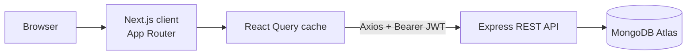

# Doctor Tracker Web

Doctor Tracker is a secure admin portal for managing doctors and their patients. Admins sign in, add doctors, assign patients, search and filter long lists with server-side pagination, and watch live analytics (totals, patients per doctor, daily activity, common conditions) on a dashboard. This repo is the Next.js client; it talks to a separate Express API over REST.

- **Frontend repo:** https://github.com/afjalhossain31/Doctor-Tracker-web
- **Backend repo:** https://github.com/afjalhossain31/Doctor-Tracker-api
- **Live frontend:** `<paste Vercel URL>`
- **Live API:** `<paste Render URL>/api/health`
- **Demo login:** `admin@doctortracker.com` / `Admin@123`

## Tech stack

Next.js 14 (App Router), React 18, Tailwind CSS, TanStack React Query, Axios, Recharts, lucide-react, react-hot-toast. JavaScript.

## Features

- Secure login, protected routes (Next.js middleware plus client guard), automatic sign-out on expired token
- Doctors: create, list, debounced search, filter by specialization, hospital and date range, sort, pagination, delete
- Doctor detail: view that doctor's patients, add and delete patients
- Patients page: list, edit, delete, search, filter by condition, doctor, gender and date, pagination
- Dashboard: total doctors and patients, patients per doctor, 30-day activity chart, condition donut, specialization chart, recent patients
- Responsive layout (mobile drawer menu, tables become cards on small screens), loading skeletons, empty states, inline form errors

## Setup Guide

The API must be running first (see the backend repo).

```bash
git clone https://github.com/afjalhossain31/Doctor-Tracker-web.git
cd Doctor-Tracker-web
cp .env.example .env.local     # Windows: copy .env.example .env.local
npm install
npm run dev                    # http://localhost:3000
```

| Variable | Purpose |
| --- | --- |
| `NEXT_PUBLIC_API_URL` | API base URL including `/api`, e.g. `http://localhost:5000/api` |

Restart `npm run dev` after changing `.env.local`. For production, `npm run build` then `npm start`.

## System Architecture



```
src/
  app/login            sign-in page
  app/(app)/           protected area: dashboard, doctors, doctors/[id], patients
  components/          Shell, DoctorForm, PatientForm, PatientTable, ui/*
  hooks/               useDebounce
  lib/                 api (Axios + interceptors), auth (Context), format helpers
  middleware.js        redirects visitors without a session
```

Flow: login calls the API and stores the JWT. An Axios interceptor adds it to every request, and a 401 response clears the session and returns to `/login`. Pages request data with filters as query params and React Query caches each result by those params.

## Technical Decisions

**1. React Query instead of Redux or Context for server state.** Nearly all state here is server data: lists, filters, counts. React Query provides caching keyed by filter params, `keepPreviousData` for flicker-free pagination, request de-duplication and targeted invalidation after mutations (adding a patient refreshes the doctor, patients and dashboard queries). Only small UI state (open modal, filter inputs) lives in component state, and auth is a tiny Context. This removes reducer boilerplate and hand-written loading and error flags.

**2. Server-driven lists with debounced input.** Search, filters, sort and pagination run on the server, so the browser only holds one page at a time and stays fast with large data. Search is debounced by 350 ms to avoid a request per keystroke, and changing any filter resets to page 1. Shared pieces (`PatientTable`, `Pagination`, `Modal`, `ConfirmDialog`, forms) are reused across pages to keep components small and avoid duplicate re-renders and code. Trade-off: the session cookie used by middleware is only a redirect hint; real authorization is enforced by the API on every request.

## Deployment (Vercel)

1. Import this repo in Vercel (framework auto-detects Next.js).
2. Add env var `NEXT_PUBLIC_API_URL=https://<your-render-app>.onrender.com/api` (no trailing slash).
3. Deploy. Then set `CLIENT_URL` on the Render API to your Vercel URL so CORS allows it.
4. Changing `NEXT_PUBLIC_API_URL` needs a redeploy, since it is baked in at build time.

## Visual Evidence

Desktop (1440px) and mobile (390px) screenshots:

| Desktop | Mobile |
| --- | --- |
|  |  |
|  |  |
|  |  |
|  |  |